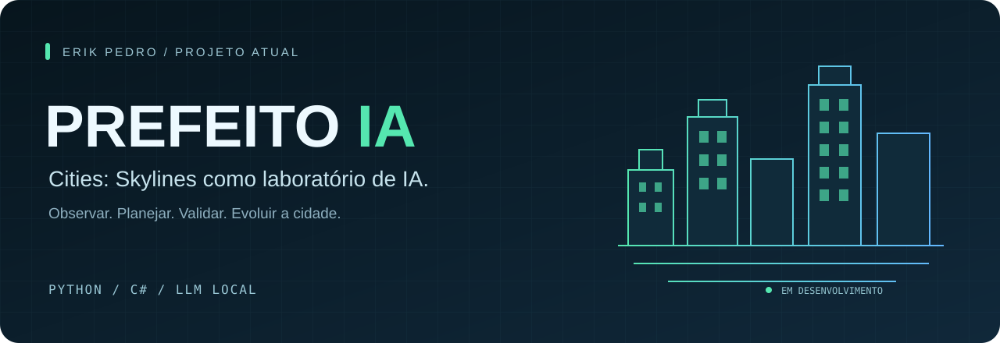

<strong>ERIK PEDRO / SOFTWARE DEVELOPMENT</strong>

<h1 align="center">Código que transforma ideias em projetos.</h1>

Desenvolvimento de software, automação e inteligência artificial aplicada. Atualmente construindo o Prefeito IA para Cities: Skylines.

---

### Projeto principal · Em desenvolvimento

**[CitiesSkylines-PrefeitoIA](https://github.com/erikpedro/CitiesSkylines-PrefeitoIA)**

Um prefeito experimental com **LLM local**, agente em **Python** e mod em **C#** para estudar decisões e planejamento urbano no Cities: Skylines 1.

| Observar | Planejar | Executar com controle |
| :--- | :--- | :--- |
| Consultar o estado da cidade e investigar problemas. | Analisar informações com o prefeito e perfis de secretários. | Validar operações permitidas, criar checkpoints e verificar resultados. |

`Python` · `C#` · `LLM local` · `Cities: Skylines 1`

O projeto evolui por etapas: diagnóstico, planejamento inspirado em Brasília e construção de trechos de vias com validação. A construção usa um planejador determinístico; o ciclo geral da LLM permanece limitado a inspeções e espera.

[Explorar o projeto →](https://github.com/erikpedro/CitiesSkylines-PrefeitoIA) · [Documentação →](https://github.com/erikpedro/CitiesSkylines-PrefeitoIA#readme)

Construído a partir do projeto MIT <a href="https://github.com/Sunwood-ai-labs/cities-skylines1-agent-skill">cities-skylines1-agent-skill</a>, da Sunwood AI Labs, com agente Python e controles próprios. Projeto independente, sem vínculo com os criadores do jogo.
